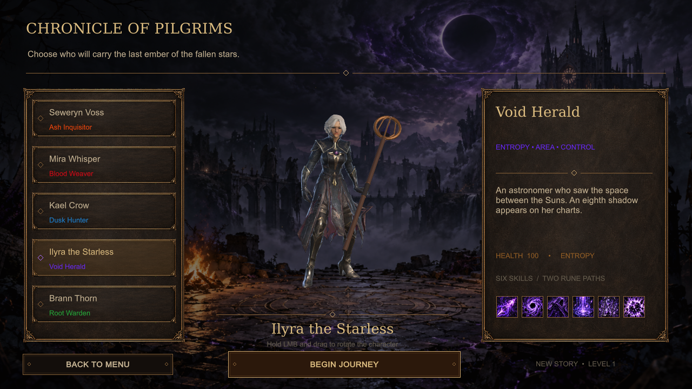

# Nocturnis: Harvest of Fallen Stars

An isometric dark fantasy action RPG. **Act I · version 0.8.4 · Polish / English · Windows x64**, built with Unity 6000.3.26f1.

[Download the game and complete Unity project](https://github.com/KonradLe/nocturnis/releases/tag/v0.8.4) · [Watch the trailer](https://zautomatyzowani.ai/nocturis) · [Polski](README.pl.md)

## Play

1. Download **Nocturnis-0.8.4-Windows-x64.zip** from Releases.
2. Extract the entire folder to a drive with enough free space.
3. Run **Nocturnis-0.8.4/PLAY.cmd** (GRAJ.cmd also works).
4. On first launch, choose **POLSKI** or **ENGLISH**, then watch or skip the opening cinematic.

Switch languages at any time under **Settings → Language** or **Ustawienia → Język**. The choice is saved independently of character saves. Both languages use English cinematic narration, with matching Polish or English subtitles and intro title cards. Menu, HUD, dialogue, quests, talents, item descriptions, shops and settings follow the selected language.

This is a portable release: Unity is not required to play. Keep the files beside Windows/Nocturnis.exe together. Saves remain in your Windows user profile, outside the installation folder. Select Low graphics on older hardware. Minimum hardware requirements have not been established through representative benchmarks.

## Act I

- Five classes: Ash Inquisitor, Blood Weaver, Dusk Hunter, Void Herald and Root Warden.
- Oakhaven as the town hub and **19 Act I locations**: 14 on the main route and five side areas.
- Character levels, talent trees, equipment, loot, trading, main quests and side quests.
- Woodland, cellars, catacombs, crypts and the final boss, Malazar.
- Graphics, sound and control settings; music reacts to combat.
- Three PBR stone-floor sets across 12 interiors, introduced in 0.8.3.

This is a development version of Act I. The trailer uses 0.8.2 footage and Polish subtitles; the English screenshots on this page show 0.8.4.

## Unity project

Git tracks code, shaders, the startup scene, localization text, package configuration and project settings. **Bulk assets are supplied through the private release archive**, rather than Git history. Download **Nocturnis-0.8.4-Unity-project.zip** for the complete models, textures, materials, prefabs, animations, audio and localized intro videos.

The simplest option is to extract that archive into an empty directory and open it with **Unity 6000.3.26f1**, including Windows Build Support (Mono). Startup scene: Assets/Scenes/Krypta.unity.

To work from a Git clone, download the matching project archive and run:

    python tools/restore_project.py --archive "F:/Downloads/Nocturnis-0.8.4-Unity-project.zip"

Python 3.10+ is required; the script uses only the standard library. It verifies the archive and every source file against SHA-256, restores missing files and refuses to overwrite local edits. Run it before first opening Unity, which may subsequently update import metadata. Restored bulk assets remain local and are excluded by .gitignore.

Unity recreates Library and resolves packages on first opening. A valid Unity licence and network access for the package manager are required. TRELLIS/DINO models, generation servers and API keys are not required to build or play the game.

## Build

Create a Logs directory, then run the following arguments as one command:

    Unity -batchmode -nographics -quit -projectPath <PROJECT>
          -buildTarget StandaloneWindows64
          -executeMethod Krypta.Editor.NocturnisLanguageBuild.Windows
          -logFile <PROJECT>/Logs/build.log

Output: Builds/Language084Windows/Nocturnis.exe. The editor must have the target build module installed.

## Localization

Runtime code: Assets/Scripts/NocturnisLanguage.cs. Translation catalog: Assets/Resources/Localization/strings.json. Polish is the original text; English is applied at the display boundary, including dynamic text fragments. Stable save keys, item identifiers and quest state are unchanged. Language selection uses a separate persisted preference.

Intro videos: Assets/StreamingAssets/Nocturnis-Intro.mp4 (Polish subtitles) and Nocturnis-Intro-en.mp4 (English subtitles). Their repaired English audio mix is identical. Attribution is available in Polish and English in the game's credits.

## Verification and licences

The release notes describe the checks performed for this build. This is not a claim of a complete campaign playthrough or an FPS benchmark.

Use SHA256SUMS.txt from Releases to verify downloads. docs/project-files.json records the complete source snapshot used for the build.

This repository is private. The game is not distributed under a blanket open-source licence. Component licences, authors and historical source notes are preserved in [Licenses](Licenses/README.md).
