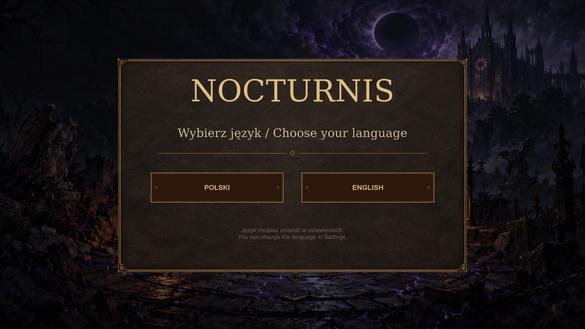

# Nocturnis: Żniwo Upadłych Gwiazd

Izometryczne action RPG w mrocznym świecie fantasy. **Akt I, wersja 0.8.4**, Unity 6000.3.26f1, Windows x64.

[**Pobierz grę i pełny projekt**](https://github.com/KonradLe/nocturnis/releases/tag/v0.8.4) · [Zwiastun](https://zautomatyzowani.ai/nocturis)

[English](README.md)

## Uruchomienie gry

1. Pobierz **Nocturnis-0.8.4-Windows-x64.zip** z Releases.
2. Rozpakuj cały katalog na dysk z wolnym miejscem.
3. Uruchom **Nocturnis-0.8.4/GRAJ.cmd**.
4. Przy pierwszym uruchomieniu wybierz **POLSKI** albo **ENGLISH**.

Język zmienisz również przez **Ustawienia → Język**. Wybór jest zapamiętywany niezależnie od zapisów postaci. Menu, HUD, zadania, dialogi, talenty, ekwipunek i sklepy korzystają z wybranego języka. Lektor intro pozostaje angielski; napisy i plansze są polskie lub angielskie.

To wydanie przenośne; Unity nie jest potrzebne do grania. Zachowaj wszystkie pliki przy Windows/Nocturnis.exe. Zapisy pozostają w profilu użytkownika Windows, poza katalogiem gry. Na słabszym sprzęcie wybierz niski profil grafiki. Nie opublikowano jeszcze pomiarów pozwalających podać rzetelne minimalne wymagania sprzętowe.

## Zawartość Aktu I

- Pięć klas: Inkwizytor Popiołów, Tkacz Krwi, Łowca Zmierzchu, Zwiastun Próżni i Strażnik Korzeni.
- Oakhaven jako miejski punkt wypadowy oraz 19 lokacji Aktu I: 14 głównej trasy i pięć pobocznych.
- Rozwój poziomów i talentów, ekwipunek, łupy, handel, zadania główne i poboczne.
- Tereny leśne, podziemia, katakumby, krypty i finałowy boss Malazar.
- Ustawienia obrazu, dźwięku i sterowania; muzyka reagująca na walkę.
- Od 0.8.3: trzy zestawy kamiennych materiałów PBR i ciągłe powierzchnie podłóg w 12 wnętrzach.

To aktualna wersja rozwojowa Aktu I. Materiał zwiastuna pochodzi z 0.8.2; powyższy zrzut przedstawiają 0.8.4.

## Projekt Unity

Git zawiera kod, shadery, scenę startową, konfigurację pakietów i ustawienia projektu. **Duże zasoby nie są zapisane w historii Git.** Komplet modeli, tekstur, materiałów, prefabów, animacji, dźwięków i intro znajduje się w archiwum **Nocturnis-0.8.4-Unity-project.zip** w tym samym wydaniu.

Najprościej rozpakuj pełny projekt do osobnego pustego katalogu i otwórz go w **Unity 6000.3.26f1** z modułem Windows Build Support (Mono). Scena: Assets/Scenes/Krypta.unity.

Aby pracować w klonie repozytorium, pobierz archiwum projektu, a następnie uruchom:

    python tools/restore_project.py --archive "F:/Downloads/Nocturnis-0.8.4-Unity-project.zip"

Python 3.10 lub nowszy; tylko biblioteka standardowa. Skrypt weryfikuje archiwum i wszystkie pliki źródłowe według SHA-256. Uzupełnia brakujące pliki i odmawia nadpisania istniejących zmian. Uruchom go przed pierwszym otwarciem Unity; edytor może później zmieniać pliki importu. Zasoby pozostają lokalnie w klonie, objęte .gitignore.

Pierwsze otwarcie projektu odtworzy Library i pobierze pakiety Unity. Potrzebne są aktywna licencja Unity i dostęp do internetu dla menedżera pakietów. Modele TRELLIS/DINO, klucze API i serwery generujące nie są potrzebne do uruchomienia gry.

W tym projekcie rozwój Unity odbywa się na serwerze; lokalny pakiet na Windows służy do grania i archiwizacji.

## Budowanie

Ze sceny Assets/Scenes/Krypta.unity można zbudować Windows x64 w Unity. Metoda użyta przez wydanie:

    Unity -batchmode -nographics -quit -projectPath <PROJECT>
          -buildTarget StandaloneWindows64
          -executeMethod Krypta.Editor.NocturnisLanguageBuild.Windows
          -logFile <PROJECT>/Logs/build.log

Przekaż argumenty w jednej komendzie. Wynik: Builds/Language084Windows/Nocturnis.exe. Katalog Logs trzeba utworzyć przed uruchomieniem. Unity musi mieć zainstalowany docelowy moduł builda.

## Weryfikacja wydania

Zakres testów wersji 0.8.4 jest opisany w informacjach wydania. Nie jest to deklaracja pełnego testu kampanii ani benchmarku FPS.

SHA256SUMS.txt w Releases pozwala sprawdzić pobrane archiwa. Plik docs/project-files.json opisuje dokładną zawartość źródeł z momentu budowania.

## Licencje

Repozytorium jest prywatne. Nie nadano grze licencji open source. Licencje poszczególnych składników, autorzy i wcześniejsze informacje źródłowe są w [Licenses](Licenses/README.md). Uprawnienia dostawców zasobów pozostają odrębne od uprawnień do kodu gry.
